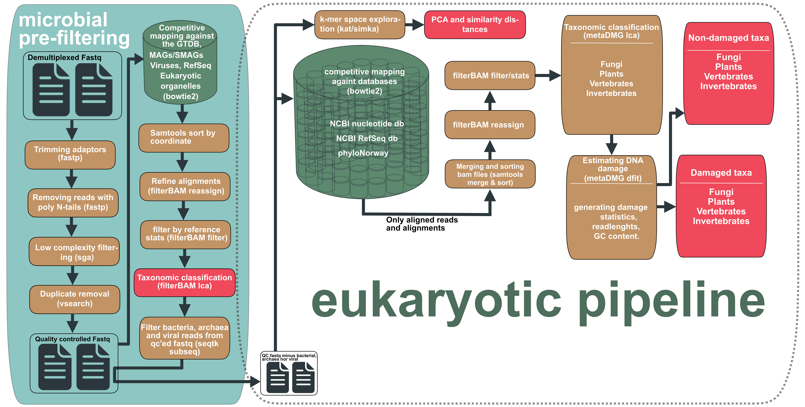
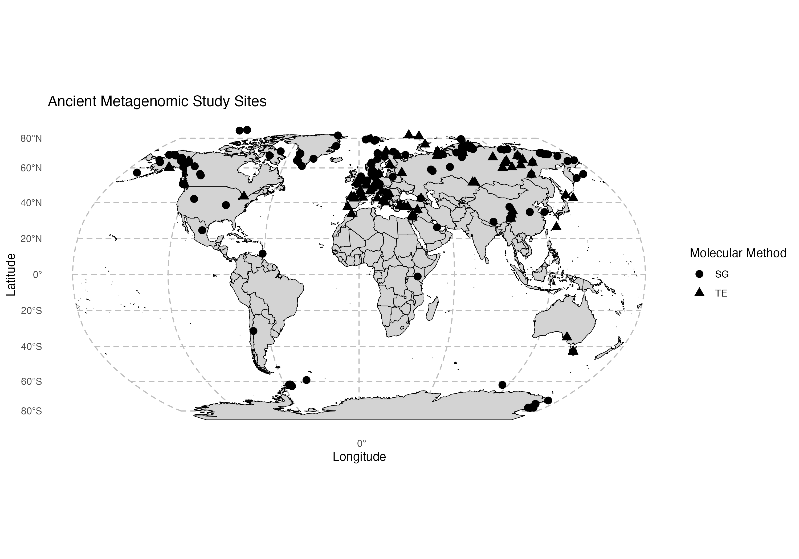
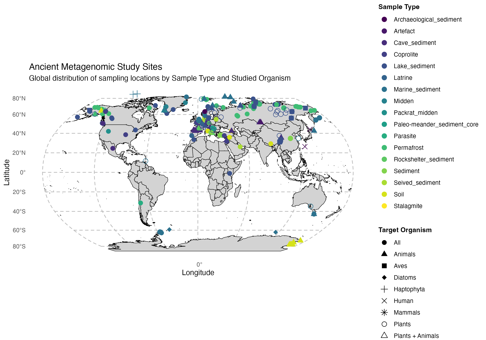
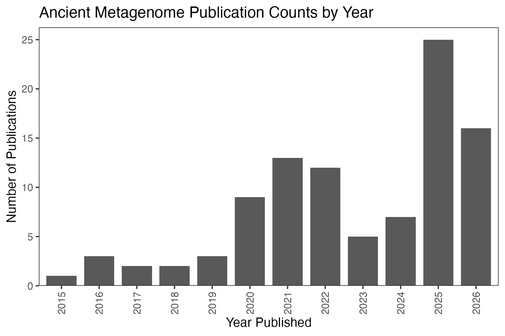
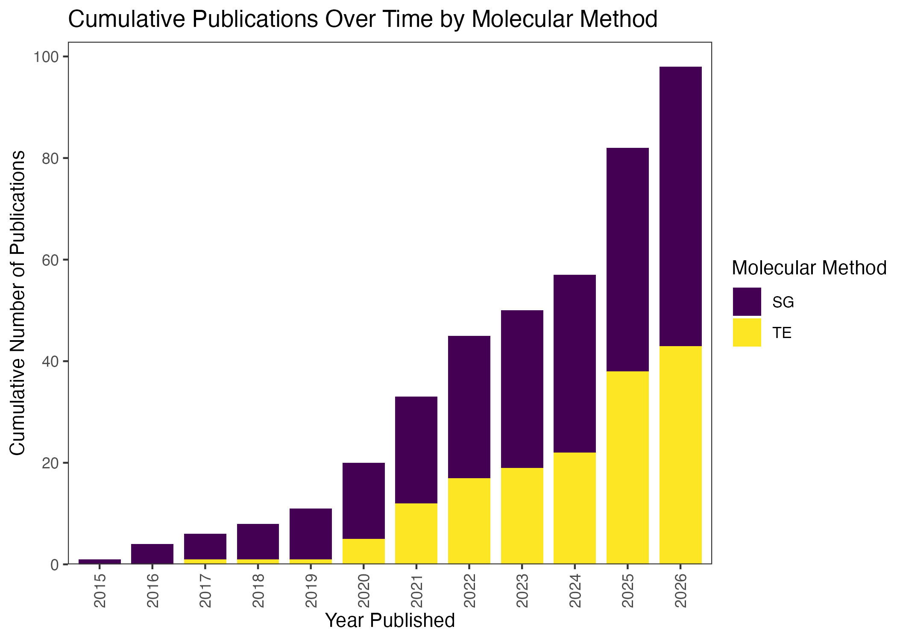
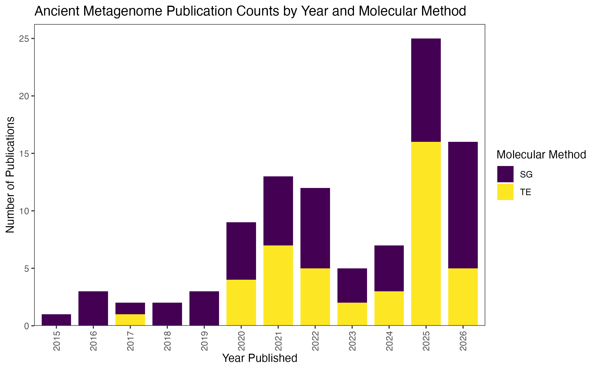
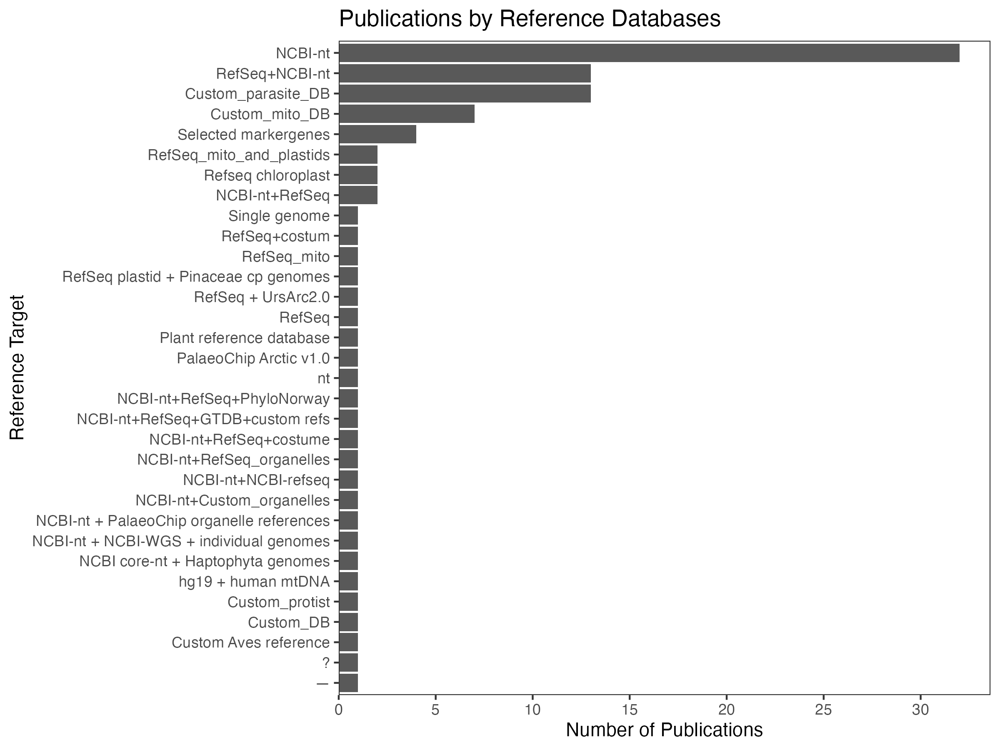
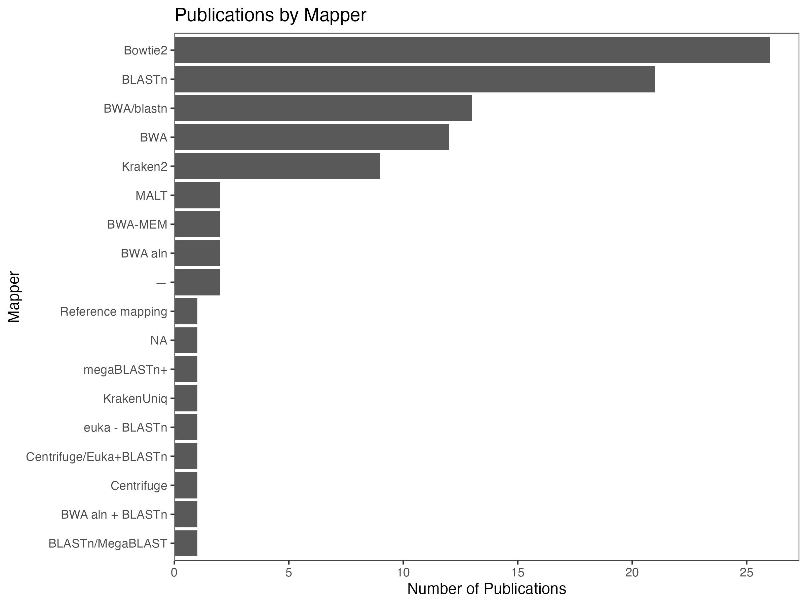

[](https://doi.org/10.5281/zenodo.18328110)

# Holi

### A holistic pipeline for ancient metagenomics

Holi processes ancient environmental DNA through read preprocessing, competitive mapping, taxonomic assignment, and authenticity assessment. It focuses on the eukaryotic fraction of complex environmental and archaeological samples and brings together read-level, reference-level, and taxonomic evidence for interpretation.

This repository also maintains a literature compilation and interactive explorer for eukaryotic ancient metagenomic studies using shotgun sequencing or capture enrichment.

**[Explore the literature](https://miwipe.github.io/Holi/)** · **[Read the documentation](docs/README.md)** · **[Open the source spreadsheet](https://docs.google.com/spreadsheets/d/13cmBUi4cigUaTKtQeFLFvS0gXT8AeWxWKzHv2UcOBCI/edit#gid=0)** · **[GitHub wiki](https://github.com/miwipe/Holi/wiki)**

> `holi_dev` is the documentation and dashboard development branch. The public explorer and GitHub wiki may still show the released version. The proposed wiki pages are versioned in [docs/wiki](docs/wiki/Home.md).

## Start here

| I want to… | Start with |
| --- | --- |
| Set up and run Holi | [Getting started](docs/wiki/Getting-started.md) and [running the pipeline](docs/wiki/Running-Holi.md) |
| Understand the eight analysis stages | [Workflow](docs/wiki/Pipeline-workflow.md) |
| Build a reference catalogue | [Reference catalogue](docs/wiki/Reference-catalogue.md) |
| Collect QC and merged taxonomic outputs | [Butteracid postprocessing](docs/wiki/Postprocessing.md) |
| Explore or update the literature | [Literature and figures](docs/wiki/Literature-and-figures.md) |
| Work on the dashboard or documentation | [Development guide](docs/DEVELOPMENT.md) |

## Analysis workflow



1. **Preprocess reads:** trim, merge paired reads, remove duplicates, and filter low-complexity sequences.
2. **Map to microbial references:** collect alignments against the configured microbial catalogue.
3. **Split reads:** separate microbial assignments and reads retained for eukaryotic analysis.
4. **Map to eukaryotic references:** align against the configured nuclear and organelle catalogues.
5. **Merge competitive alignments:** combine reference sets before downstream filtering.
6. **Filter alignments:** use Unicorn to filter alignments and compute reference and BAM statistics.
7. **Estimate damage:** run metaDMG assignment, fitting, and aggregation.
8. **Summarise taxonomy:** calculate rank-level Unicorn statistics.

Taxonomic assignment alone does not establish that a sequence is ancient. Interpret fragment lengths, damage estimates, coverage, controls, and archaeological or environmental context together. Reads retained after microbial filtering are not a measure of eukaryotic mapping success.

## Run Holi

The supplied analysis environment targets Linux. Reference databases, taxonomies, and the executables required by the selected stages must be available before a full run. The reference layout in the current script is specific to the existing indexed catalogues; inspect it before substituting a different database build.

```bash
git clone https://github.com/miwipe/Holi.git
cd Holi

conda env create -f envs/holi.yml
conda activate holi

cp config/holi.example.yml config/holi.local.yml
cp config/samples.example.list config/samples.local.list
# Edit both files for your inputs, outputs, database indexes, and taxonomy.

bash bin/holi.sh config/holi.local.yml config/samples.local.list
```

Options follow the two positional arguments. To restrict a run to stages 4–6:

```bash
bash bin/holi.sh config/holi.local.yml config/samples.local.list --from-stage 4 --to-stage 6
```

See [Running Holi](docs/wiki/Running-Holi.md) for input naming, resume behaviour, stage controls, and cleanup options. The original files in `bin/` remain available for existing workflows; the new examples contain placeholder paths.

## Literature compilation

The [Google Sheet](https://docs.google.com/spreadsheets/d/13cmBUi4cigUaTKtQeFLFvS0gXT8AeWxWKzHv2UcOBCI/edit#gid=0) records study locations, sample types, target groups, sequencing methods, databases, mapping tools, and authentication approaches. It builds on the [Inventory of ancient environmental DNA from sedimentary archives](https://doi.org/10.5281/zenodo.6847521) and extends coverage to other environmental and archaeological materials. Studies using only metabarcoding are outside the eukaryotic metagenomics compilation's scope.

The `Eukaryotes` tab is the source for the literature figures and dashboard. The workbook also contains a microbial literature tab and working lists. A row represents a site record; the same paper or locality can occur more than once. Publication summaries deduplicate by DOI within the relevant group. Papers using several methods or databases can appear in several categories.

**DOI curation is in progress.** Proposed corrections are listed in the [DOI review tab](https://docs.google.com/spreadsheets/d/13cmBUi4cigUaTKtQeFLFvS0gXT8AeWxWKzHv2UcOBCI/edit#gid=1498244963). This branch preserves the existing source identifiers and figure files pending review. Distinct DOI counts should not be interpreted as independently verified publication totals.

### Study locations





### Publication trends





<details>
<summary>Methods, reference databases, and mappers</summary>







</details>

### Regenerate the figures

From the repository root, with R and the packages listed in the script available:

```bash
Rscript literature/R/generate_figures.R
```

The script reads the live `Eukaryotes` tab using `googlesheets4`, may prompt for Google authentication, and writes to `figures/`. It currently installs missing R packages when run. Review the live data before replacing the committed figures. You can also open `literature/R/sedaDNA_litterature.Rproj` in RStudio. [Details](docs/wiki/Literature-and-figures.md).

## Repository layout

```text
bin/                         Analysis and postprocessing entry points
envs/                        Conda environment definitions
config/                      Portable example configs and sample list
docs/wiki/                   Proposed, maintained GitHub wiki pages
docs/wiki-archive/            Original wiki snapshot for provenance
literature/R/                R project, plotting script, exploratory code
data/literature/             Dashboard snapshot and source provenance
dashboard/                   Literature explorer code, styles, pinned assets
dashboards/reference-catalog/ Existing reference catalogue dashboard
figures/                     Workflow and existing publication figures
scripts/                     Dashboard build and repository validation
index.html                   GitHub Pages literature explorer
```

Legacy literature paths and the original reference-catalogue URL have compatibility links. PDF articles remain in the separately curated literature folder and are not added to this repository.

## Contribute

For literature corrections or additions, comment in the source spreadsheet and include a DOI and the relevant site. Review proposed DOI changes before applying them to the source tables. For code or documentation changes, use a development branch and follow the [development guide](docs/DEVELOPMENT.md).

## Cite Holi

Pedersen, M. W., Vogel, N. A., Holman, L. E., & Wang, Yi (2026). *Holi* (Version 1.0.0) [Software]. Zenodo. [https://doi.org/10.5281/zenodo.18328110](https://doi.org/10.5281/zenodo.18328110).

Holi is distributed under [GPL-3.0](LICENSE). Bundled dashboard libraries retain their upstream licences; see [dashboard/vendor/README.md](dashboard/vendor/README.md).
